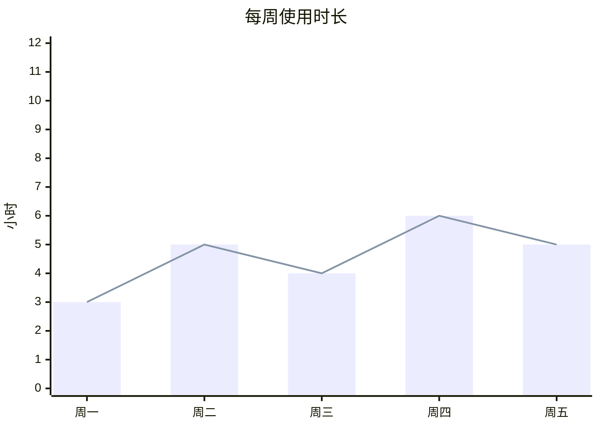
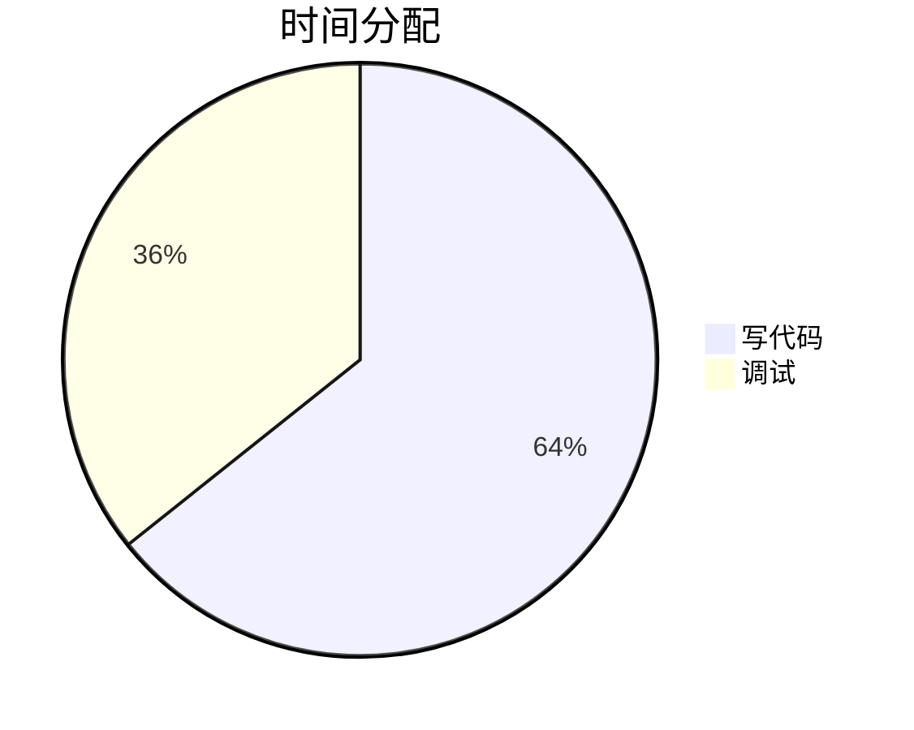

# 图表 · dsh-chart

给 [DeepSeek Harness](https://github.com/deepseek-ai/deepseek-harness) 的回复加图表能力：
写 `mermaid` 代码块，直接渲染成图表卡片。

mermaid 11.16 已内联进 `client.js`，**离线可用、零外部依赖**，拷到任何 DSH 机器上都能跑。

## 特性

- **图 / 表 / 原文三视图**：卡片右上角三个小图标，随时切换
  - `▮` 图表视图
  - `▦` 表格视图（从图表源码里自动抽数据）
  - `<>` 原文视图（不渲染的源码块）
- **自绘渲染**：柱状图 / 折线图 / 饼图由插件自己画 SVG，圆角柱、亮色配色、分组柱（多个 `bar` 数组自动并排）
- **语法校验**：先过 mermaid 的 `parse`，标准写法走标准路径；解析不了就降级兼容渲染，并打上黄色的「⚠ 语法不标准」标记
- **系统提示词只放指针**：插件往系统提示词里注入三行短提示（能画图 / 一图一块 / 末行写 `%%`），
  严格的 mermaid 格式、模板和自检清单放在技能 [`chart`](../../.dsh/skills/chart/SKILL.md) 里，模型要画时才加载 —— 常驻上下文省了，格式反而更严
- **渲染缓存**：画好一张图就把 SVG 压成 zstd 存到磁盘（`$DSH_HOME/cache/dsh-chart/`，默认 `/.dsh/cache/dsh-chart/`），
  页面重开时直接从缓存铺上去，不再重跑 mermaid；改了主题/渲染逻辑改 `CACHE_VER` 即可整体失效。
  插件卸载/停用时会连同这个缓存目录一起删掉
- **容错**：流式输出时等代码块写完（450ms 稳定）再渲染；失败自动重试 3 次

## 用法

在回复里写一个 `mermaid` 代码块：

````

````

````

````

支持的图：

| 语法 | 效果 |
|---|---|
| `xychart-beta` + `bar` | 柱状图（圆角柱；多个 `bar` 会并排分组） |
| `xychart-beta` + `line` | 折线图 |
| `pie` | 饼图 |
| `flowchart` / `sequenceDiagram` / `gantt` / `mindmap` … | mermaid 全部图类型（走 mermaid 渲染） |

## 命令

输入框里敲 `/` 就能看到（客户端命令，不提交消息、不花 token）：

| 命令 | 作用 |
|---|---|
| `/rechart` | 整页重载，把当前会话的图表重新画一遍（有缓存就直接用缓存） |
| `/rechart-clear` | 清空渲染缓存，然后重画一遍 |

图表显示残缺/没画出来时，先 `/rechart`；还不对就 `/rechart-clear`。

> ⚠️ `x-axis` 的中文标签必须加引号：`["一月", "二月"]`，否则 mermaid 语法校验不通过，会降级成兼容渲染并标黄。

## 安装

```bash
# 从本地目录
dsh plugin --profile web add file:/path/to/dsh-chart

# 或从打包好的 tarball
dsh plugin --profile web add file:/path/to/dsh-chart-1.1.0.tgz
```

装完重启 `dsh web`（客户端 bundle 的 rev 在启动时计算），刷新页面即可。

> 格式规范放在技能里：把 `SKILL.md` 装到 `~/.dsh/skills/chart/SKILL.md`。缺了它插件照样渲染，
> 只是模型手里没有严格模板可抄。

## 开发

```bash
npm run build     # src/chart.js + src/vendor/mermaid.min.js → client.js
npm pack          # 打 tarball
```

仓库结构：

```
.
├── package.json          # name / icon / description / exports / dsh 声明
├── index.js              # 宿主半侧：注入系统提示词 + 缓存读写接口 + 卸载清理
├── client.js             # 浏览器半侧（构建产物，内含 mermaid）
├── cordis.patch.yml      # bundle 挂载
├── src/
│   ├── chart.js          # 图表逻辑源码（可读，不带 mermaid）
│   └── vendor/
│       └── mermaid.min.js
├── scripts/build.mjs     # 构建脚本
├── assets/icon.svg       # 插件图标
├── locale/zh.json        # 标题「图表」+ 中文简介
├── skill/SKILL.md        # 技能 chart 的正文（严格的 mermaid 模板 + 自检清单）
├── locale/en.json        # Title "Chart" + English description
└── LICENSE
```

## 缓存

| 项目 | 说明 |
|---|---|
| 目录 | `$DSH_HOME/cache/dsh-chart/`（默认 `/.dsh/cache/dsh-chart/`），一张图一个文件 |
| 能压才压 | 先试 **zstd**（Node 自带，level 3）；压完至少省 16 字节才写成 `<key>.json.zst`，否则原样写 `<key>.json` —— 不再为了"有压缩"反而变大 |
| 不压的情况 | 小于 256 字节、压缩没收益、或内容本身已是压缩格式（zstd / gzip / zip / lz4 / 7z / bz2 / xz 魔数） |
| 实测 | 纯文本 SVG 压到 **约 14%**（45.7KB → 6.5KB）；老 Node 退回 deflateRaw；两种后缀都能读 |
| key | 图表源码（去掉 `%%`/`title` 行）的 FNV-1a 双哈希 + `CACHE_VER`，换逻辑改 `CACHE_VER` 即失效 |
| 接口 | `GET /dsh-chart-cache/<key>` 取、`POST /dsh-chart-cache/<key>` 存、`POST /dsh-chart-cache/clear` 清空 |
| 清理 | 插件卸载/停用/重载时自动 `rm -rf` 整个缓存目录 |

## License

MIT。内联的 mermaid 11.16 同样为 MIT（Copyright Knut Sveidqvist and contributors）。
