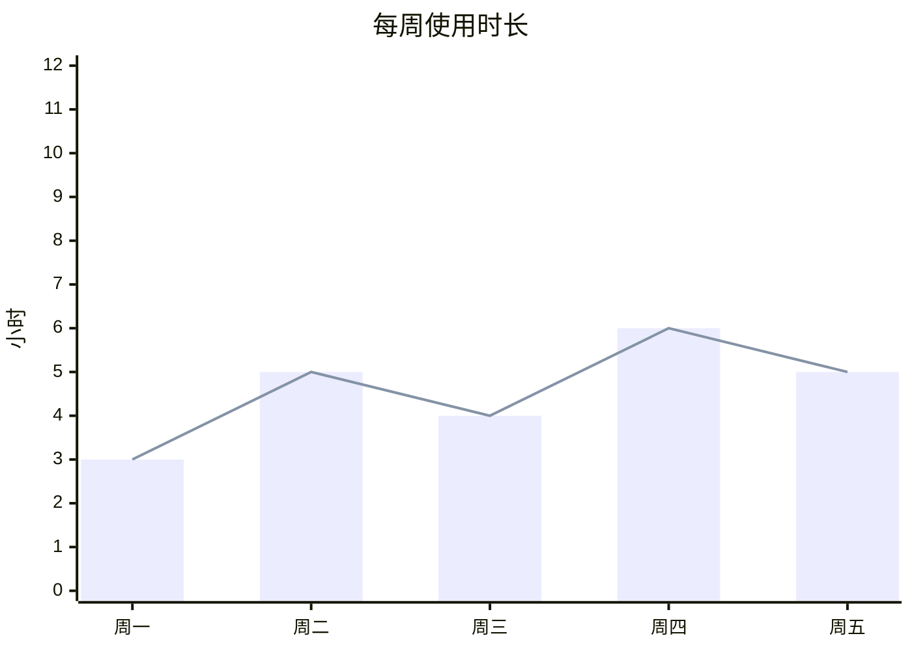
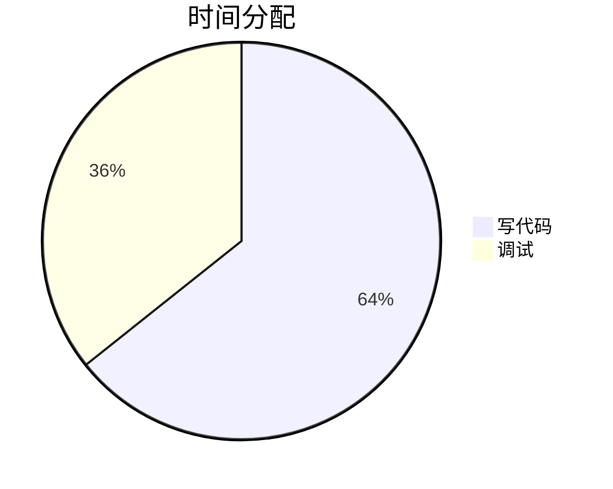

# 图表 · dsh-chart

给 [DeepSeek Harness](https://github.com/deepseek-ai/deepseek-harness) 的回复加图表能力：
写 `mermaid` 代码块，直接渲染成图表卡片。

mermaid 11.16 已内联进 `client.js`，**离线可用、零外部依赖**，拷到任何 DSH 机器上都能跑。

## 特性

- **图 / 表 / 原文三视图**：卡片右上角三个小图标，随时切换
  - `▮` 图表视图
  - `▦` 表格视图（从图表源码里自动抽数据）
  - `<>` 原文视图（不渲染的源码块）
- **自绘渲染**：柱状图 / 折线图 / 饼图由插件自己画 SVG，圆角柱、亮色配色、分组柱（多个 `bar` 数组自动并排）
- **语法校验**：先过 mermaid 的 `parse`，标准写法走标准路径；解析不了就降级兼容渲染，并打上黄色的「⚠ 语法不标准」标记
- **系统提示词注入**：插件会自动告诉模型"你可以用 mermaid 画图"，模型会主动画
- **容错**：流式输出时等代码块写完（450ms 稳定）再渲染；失败自动重试 3 次

## 用法

在回复里写一个 `mermaid` 代码块：

````

````

````

````

支持的图：

| 语法 | 效果 |
|---|---|
| `xychart-beta` + `bar` | 柱状图（圆角柱；多个 `bar` 会并排分组） |
| `xychart-beta` + `line` | 折线图 |
| `pie` | 饼图 |
| `flowchart` / `sequenceDiagram` / `gantt` / `mindmap` … | mermaid 全部图类型（走 mermaid 渲染） |

> ⚠️ `x-axis` 的中文标签必须加引号：`["一月", "二月"]`，否则 mermaid 语法校验不通过，会降级成兼容渲染并标黄。

## 安装

```bash
# 从本地目录
dsh plugin --profile web add file:/path/to/dsh-chart

# 或从打包好的 tarball
dsh plugin --profile web add file:/path/to/dsh-chart-1.1.0.tgz
```

装完重启 `dsh web`（客户端 bundle 的 rev 在启动时计算），刷新页面即可。

## 开发

```bash
npm run build     # src/chart.js + src/vendor/mermaid.min.js → client.js
npm pack          # 打 tarball
```

仓库结构：

```
.
├── package.json          # name / icon / description / exports / dsh 声明
├── index.js              # 宿主半侧：注入系统提示词
├── client.js             # 浏览器半侧（构建产物，内含 mermaid）
├── cordis.patch.yml      # bundle 挂载
├── src/
│   ├── chart.js          # 图表逻辑源码（可读，不带 mermaid）
│   └── vendor/
│       └── mermaid.min.js
├── scripts/build.mjs     # 构建脚本
├── assets/icon.svg       # 插件图标
├── locale/zh.json        # 标题「图表」+ 中文简介
├── locale/en.json        # Title "Chart" + English description
└── LICENSE
```

## License

MIT。内联的 mermaid 11.16 同样为 MIT（Copyright Knut Sveidqvist and contributors）。
