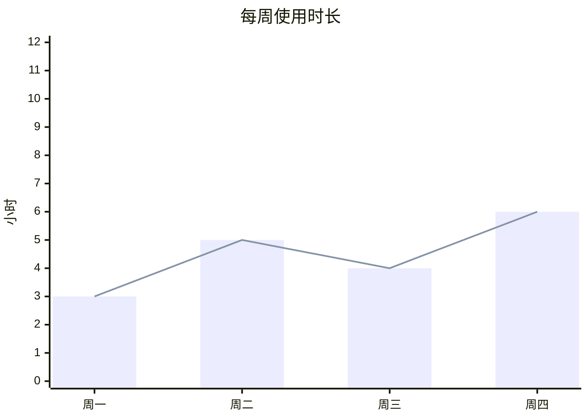
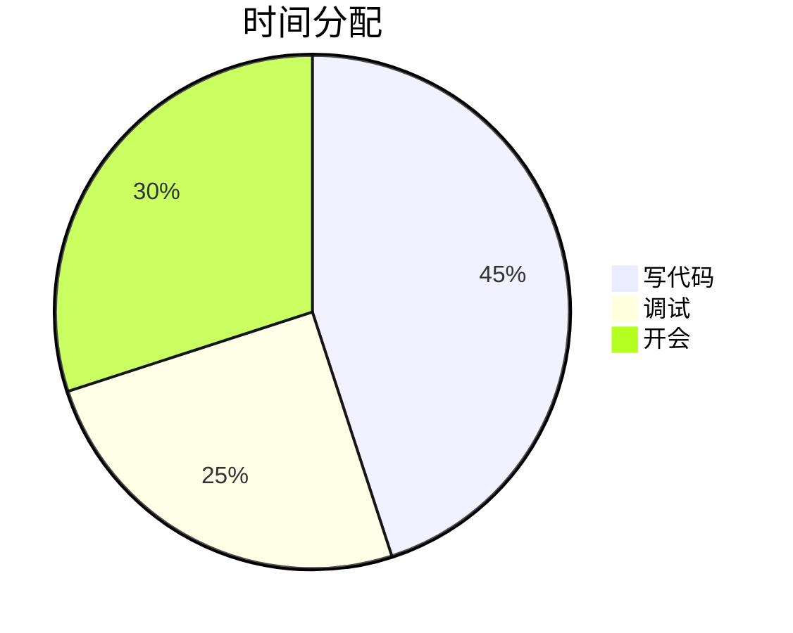
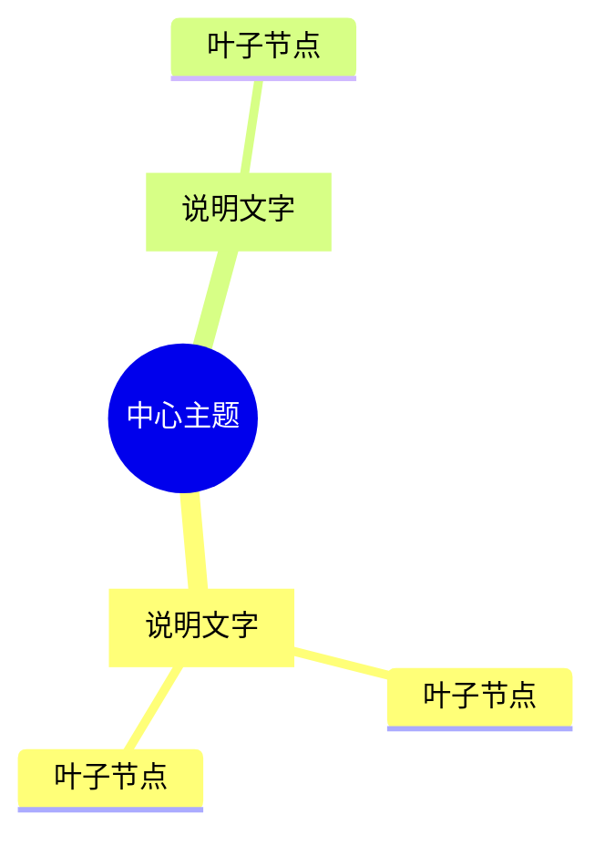

# 图表（mermaid 代码块）写法

回复里的 ```mermaid 代码块会被网页渲染成图表卡片（右上角可切 图 / 表 / 原文）。

## 三条铁律

1. 一张图一个代码块，围栏语言标 `mermaid`。
2. 代码块最后一行单独写 `%%`。插件靠它认定"这块写完了"，立刻渲染；`%%` 是 mermaid 注释，不影响图案。
3. 发出去之前，拿文末「发布前自检」逐条对一遍。对不上的结果就是卡片退化成一个代码块（或打上「⚠ 语法不标准」黄标）。

## 选什么图

mindmap（分类 / 组成 / 层级 / 从属 / 状态总览）> xychart-beta（数值对比、趋势）> pie（占比）> flowchart TB（步骤、分支）。能用 mindmap 表达的结构就用 mindmap —— 径向布局最紧凑，流程图在手机上容易被拉成又扁又长一条。

数据必须有依据：真实统计、用户给的数字或本次任务的真实结果，不编。

## 柱状图 / 折线图（xychart-beta）

````

````

- `x-axis` 后面**直接**跟方括号，中间别插轴标题；标签一律英文双引号包住，纯数字也要（`"2024"`）。
- 标签控制在 6 个字以内（超了会被截成 6 字 + …），标签里不放逗号；一组 3–10 个，太多就拆图或改表格。
- `y-axis "单位" 最小值 --> 最大值`，`-->` 前后各一个空格；单位写成短词（`小时`、`GB`），不带括号。
- `bar` / `line` 的方括号里只放数字：不加引号、不带单位、不加千分位逗号、不带百分号；数组长度跟标签数一致。
- 多个 `bar` 自动并排分组；`bar` 和 `line` 可以同时出现（柱+线是默认好看组合）；超过 6 条系列颜色会循环。

## 饼图（pie）

````

````

- 每行 `"名称" : 数值`：名称双引号，冒号前后各一个空格，数值只能是正数（不带 `%`、不带单位、不带负号）。
- `title` 可省（省了卡片标题为空）；3–8 块为宜，名称 10 字以内。

## 思维导图（mindmap，首选）

````

````

- 缩进只用空格，每级 2 个或 4 个；**敲 tab 直接解析失败**。
- 节点形状：`[方块]`、`(圆角)`、`((圆))`。根节点用 `root((中心主题))`。
- 文字里带标点就整段放进 `[...]`，而且 `[...]` 里**不出现括号** —— `a[说明(括号)]` 必报错。冒号、斜杠、逗号、引号、箭头、`<br/>`、emoji 在方括号内可以直接用。
- 层级 3–4 层，每个分支 2–6 个叶子；叶子写名词短语，不写整句。

## 流程图 / 时序图 / 甘特图等

- 流程图一律 `flowchart TB`（自上而下）。
- 节点文字带括号或标点，整体加双引号：`A["带 (括号) 的标签"]`；换行用 `<br/>`。
- `sequenceDiagram`、`stateDiagram-v2`、`gantt`、`timeline`、`quadrantChart`、`classDiagram`、`erDiagram`、`journey`、`gitGraph` 按 mermaid 官方语法写。
- 上色（可选）用好这几条：`style A fill:#4da3ff,stroke:#9ccbff,color:#0f1216`，或 `classDef hot fill:#f06292,stroke:#f06292,color:#0f1216` + `class A hot`。
- 亮色系：`#4da3ff` 蓝、`#4dd08a` 绿、`#ffb74d` 橙、`#f06292` 粉、`#ab7bf7` 紫、`#4dd0e1` 青；浅色文字 `#ffffff` / `#eef4fa` 配深色底，亮色填充上则用深色文字 `#0f1216`。
- 图可以比屏幕宽，卡片支持左右滑动 —— 保住字号，别为了塞进屏幕删细节或缩数据。

## 发布前自检

- [ ] 一个代码块一张图，围栏语言 `mermaid`
- [ ] 最后一行是单独一个 `%%`
- [ ] xychart：标签带双引号、`bar`/`line` 里只有数字、数组长度 = 标签数
- [ ] pie：`"名" : 数`，没 `%`、没单位、没负号
- [ ] mindmap：缩进全是空格；每个 `[...]` 里没有括号
- [ ] 图里的数字跟正文/数据对得上，一个没编
- [ ] 选的图型是最省屏幕的那种（结构 → mindmap，占比 → pie，趋势 → 折线）

## 图表残缺/没画出来时

- 让用户直接在输入框敲 `/rechart`（客户端命令：整页重载、把当前会话的图全部重画，有缓存就直接用缓存；不消耗 token、不产生对话）。
- 还不对就敲 `/rechart-clear`：清空图表的渲染缓存再重画。
- 不要让用户写任何标记，也不要自己重发一遍图表。
